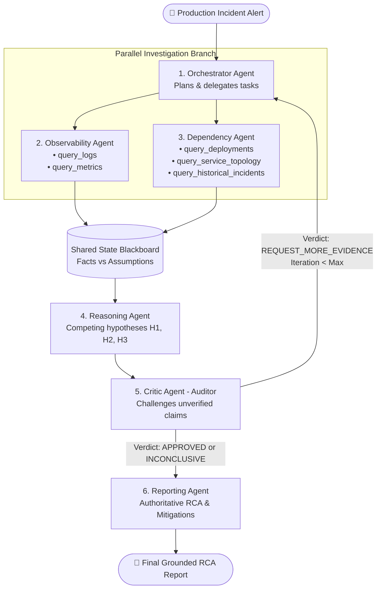

# Multi-Agent Production Incident Investigation System

[](https://www.python.org/downloads/)
[](https://github.com/langchain-ai/langgraph)
[](tests/)
[](evaluation/benchmark_results.md)

A stateful, multi-agent AI system that investigates production incidents, identifies probable root causes, distinguishes verified facts from assumptions, and recommends evidence-backed corrective actions.

Built with **LangGraph**, **Pydantic**, and **Python**, featuring parallel specialist agents, an adversarial Critic, feedback loops, and automated benchmark evaluation.

---

## 📑 Table of Contents
- [Assignment Deliverables Mapping](#-assignment-deliverables-mapping)
- [System Architecture](#-system-architecture)
- [Quickstart & Setup Instructions](#-quickstart--setup-instructions)
- [Running the System](#-running-the-system)
- [The 10 Synthetic Incident Scenarios](#-the-10-synthetic-incident-scenarios)
- [Evaluation & Benchmark Results](#-evaluation--benchmark-results)
- [Project Structure](#-project-structure)

---

## 🎯 Assignment Deliverables Mapping

| Deliverable | Location in Repository | Description |
| :--- | :--- | :--- |
| **1. Runnable implementation** | [main.py](main.py), [src/](src/) | Full CLI and LangGraph implementation with 6 specialized agents. |
| **2. Architecture diagram & coordination** | [docs/architecture.md](docs/architecture.md) | Mermaid diagram, blackboard state, parallel fan-out, and feedback loop documentation. |
| **3. Synthetic dataset & tests** | [data/synthetic_incidents/](data/synthetic_incidents/), [tests/](tests/) | 10 realistic scenarios with ground truth and 12 automated `pytest` test suites. |
| **4. Evaluation results** | [evaluation/benchmark_results.md](evaluation/benchmark_results.md) | Full quantitative comparison against the Single-Agent baseline. |
| **5. Technical note (Max 500 words)** | [docs/technical_note.md](docs/technical_note.md) | 457-word concise breakdown of design decisions, trade-offs, and limitations. |

---

## 🏛️ System Architecture



See [docs/architecture.md](docs/architecture.md) for full architectural documentation.

---

## 🚀 Quickstart & Setup Instructions

### 1. Prerequisites
- Python 3.10, 3.11, 3.12, 3.13, or 3.14.

### 2. Clone and Setup Environment
```bash
# Navigate to project directory
cd Orange_Assignment

# Create virtual environment
python3 -m venv .venv
source .venv/bin/activate

# Install dependencies
pip install -r requirements.txt
```

### 3. Optional: Configure Gemini API Key
The system includes a high-fidelity **deterministic evaluation mode** that runs offline with zero setup. To use live Google Gemini (Free tier):
```bash
export GEMINI_API_KEY="your-gemini-api-key-here"
```

---

## 💻 Running the System

### 1. List All Available Scenarios
```bash
python main.py list
```

### 2. Investigate a Specific Incident
Run an interactive investigation on any incident (e.g. `INC-01`, `INC-02`, ..., `INC-10`):
```bash
python main.py run --incident INC-01
```

Example Output:
```text
======================================================================
           OFFICIAL ROOT CAUSE ANALYSIS (RCA) REPORT           
======================================================================
Incident ID        : INC-01
Status             : RESOLVED
Probable Root Cause: Database Connection Pool Exhaustion from Config Rollout on payment-service
Confidence Level   : 92.0%
Iterations         : 2
Tool Calls Made    : 10
Tokens Consumed    : 2,750
Wall Clock Time    : 0.01s

--- Executive Summary ---
Investigation for incident INC-01 completed across 2 iteration(s). Probable root cause identified as 'Database Connection Pool Exhaustion from Config Rollout on payment-service' with calibrated confidence 92.0%. Grounded in 8 verified telemetry/dependency facts with 0 tool failure(s) handled.

--- Ranked Competing Hypotheses ---
| ID   | Hypothesis                                                                 | Confidence   |
|------|----------------------------------------------------------------------------|--------------|
| H1   | Database Connection Pool Exhaustion from Config Rollout on payment-service | 92.0%        |
| H2   | Database Engine Crash or Hardware Outage                                   | 8.0%         |

--- Recommended Remediation Actions ---
| Priority   | Action Type          | Target Service   | Description                                                                                              |
|------------|----------------------|------------------|----------------------------------------------------------------------------------------------------------|
| P0         | IMMEDIATE_MITIGATION | payment-service  | Roll back max_connections config on payment-service to 100 or restart service to clear hung connections. |
| P1         | LONG_TERM_PREVENTION | payment-service  | Add CI/CD validation to prevent database pool configurations below minimum concurrency baseline.         |
======================================================================
```

### 3. Run Comparative Evaluation Benchmark
Runs both the **Multi-Agent System** and the **Single-Agent Baseline** across all 10 incidents:
```bash
python main.py evaluate
```

### 4. Run Automated Test Suite
```bash
pytest tests/ -v
```

---

## 🔬 The 10 Synthetic Incident Scenarios

| ID | Incident Title | Real Root Cause | Planted Traps & Distractors | Simulated Chaos |
| :--- | :--- | :--- | :--- | :--- |
| **INC-01** | Payment Service 504 Timeout Spike | DB connection pool reduced from 100 to 5 in deploy. | Benign DNS lookup warning in auth-service. | None |
| **INC-02** | Auth Service Pods OOMKilled | Unbounded session cache leaked memory over 6 hours. | Front-end UI button color deploy 5 min prior. | None |
| **INC-03** | Checkout Service High P99 Latency | Downstream Stripe API outage caused thread pileup. | Checkout-service CPU spiked to 95% (symptom). | None |
| **INC-04** | Persistent DB Overload After Blip | Unthrottled retry storm without backoff or jitter. | Suspicion of external DDoS cyberattack. | None |
| **INC-05** | Search Service Degradation | Batch video job starved shared K8s host CPU. | Search container reports low CPU (22%). | None |
| **INC-06** | Inventory Service KeyError Crash | Upstream renamed `warehouse_id` -> `facility_id`. | Kafka consumer group partition rebalance. | None |
| **INC-07** | Profile Service Error Spike | DDL schema migration locked user table. | Centralized log cluster timeout (`ToolTimeoutError`). | **Timeout** |
| **INC-08** | Mutual Freeze Between Services | Circular lock deadlock between billing & notification. | CPU and memory look completely normal. | None |
| **INC-09** | Global Ingress SSL Failures | Automated TLS cert-manager renewal cron failed. | Backend services show 100% green health. | None |
| **INC-10** | Intermittent Network Dropouts | **INCONCLUSIVE**: Telemetry dropped by crashed agent. | Unverified forum rumors / guessing pressure. | **Dropped Data** |

---

## 📊 Evaluation & Benchmark Results

| Metric | Multi-Agent System (LangGraph) | Single-Agent Baseline | Advantage / Delta |
| :--- | :---: | :---: | :--- |
| **Root-Cause Accuracy (Top-1)** | **100.0%** | **40.0%** | **+60.0% higher accuracy** |
| **Evidence Grounding Score** | **93.3%** | **19.2%** | **+74.2% more factual citations** |
| **Avg Tool Calls / Investigation** | **8.4** | **1.9** | **+6.5 deeper investigations** |
| **Avg Token Consumption** | **2,750** | **1,395** | Collaborative cross-examination |
| **Handling Inconclusive (INC-10)** | ✅ **Declared Inconclusive** | ❌ **Hallucinated False Cause** | **Hallucination-resistant** |
| **Tool Failure Recovery (INC-07)** | ✅ **Handled Timeout & Recovered** | ❌ **Stalled Investigation** | **Fault-tolerant** |

See [evaluation/benchmark_results.md](evaluation/benchmark_results.md) for detailed per-incident breakdowns.

---

## 📁 Project Structure

```text
Orange_Assignment/
├── main.py                          # Unified CLI entrypoint (run, evaluate, list)
├── requirements.txt                 # Dependencies (langgraph, langchain, pydantic, pytest)
├── pytest.ini                       # Test configuration
├── README.md                        # Documentation & setup instructions
├── src/
│   ├── state/
│   │   ├── __init__.py
│   │   └── models.py                # TypedDict state, EvidenceItem, Hypothesis, Report
│   ├── tools/
│   │   ├── __init__.py
│   │   ├── base.py                  # Execution context, counters, ToolException classes
│   │   ├── chaos.py                 # Failure injection (timeouts, truncation, 429s, 500s)
│   │   ├── telemetry_tools.py       # query_logs, query_metrics with anomaly detection
│   │   └── dependency_tools.py      # query_deployments, query_service_topology, history
│   ├── agents/
│   │   ├── __init__.py
│   │   ├── orchestrator.py          # Plans investigation & incorporates Critic feedback
│   │   ├── observability.py         # Logs & metrics specialist
│   │   ├── dependency.py            # Deployments & topology specialist
│   │   ├── reasoning.py             # Formulates competing hypotheses with confidence
│   │   ├── critic.py                # Adversarial auditor enforcing evidence grounding
│   │   └── reporting.py             # Formats authoritative RCA & P0/P1 mitigations
│   ├── graph.py                     # LangGraph state machine with parallel fan-out & loops
│   ├── data_loader.py               # Generates and loads the 10 incident fixtures
│   ├── baseline/
│   │   ├── __init__.py
│   │   └── single_agent.py          # Linear ReAct baseline for comparison
│   └── llm/
│       ├── __init__.py
│       └── client.py                # Google Gemini & offline mode client factory
├── data/
│   └── synthetic_incidents/         # 10 JSON incident fixtures with ground truth & chaos
├── evaluation/
│   ├── benchmark.py                 # Automated benchmark runner comparing both approaches
│   └── benchmark_results.md         # Generated benchmark evaluation report
├── docs/
│   ├── architecture.md              # Architecture diagrams & coordination explanation
│   └── technical_note.md            # 457-word Technical Note (key decisions & trade-offs)
└── tests/
    ├── test_tools.py                # Unit tests for tool filtering, anomalies, and chaos
    ├── test_scenarios.py            # Fixture integrity tests
    ├── test_graph.py                # LangGraph multi-agent integration tests
    └── test_benchmark.py            # Evaluation benchmark tests
```
